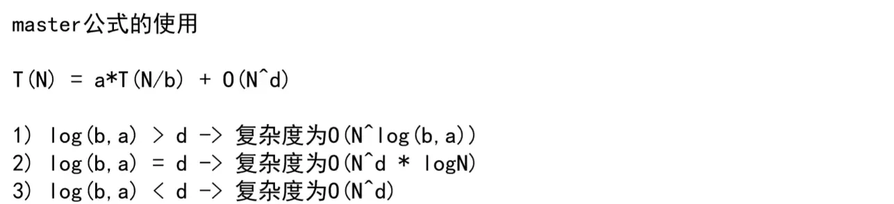

## 📖17日

---


### 学习计划

#### 上午9:00~12:00

- [x] 排序算法学习(归并排序)
- [x] 左神算法视频学习:p4(1:00:00)

#### 下午2:00~18:00

- [x] 基本设计模式(工厂模式三种P4,P5):部分完成

### 学习总结

#### 1.递归时间复杂度

需要子问题是等量的,并且a为子问题的个数,T(N/b)为子问题分成了多少份,O(N^d)为剩余时间复杂度




#### 2.归并排序(将每一个子问题排序好)

根据上述master公式,时间复杂度为O(nlogn),空间复杂度O(n)

形成一个多叉树的形式,先将每一个子问题排序好,然后依次往上,最后将所有问题排序好

代码编写

```java
public static void mergeSort(int[] arr){
    //首先排除无用项
    if (arr == null||arr.length < 2){
        return;
    }
    process(arr, 0, arr.length-1);
}

public static void process(int[] arr, int left, int right){
    //如果左边等于右边,直接返回
    if (left == right){
        return;
    }

    int mid = left + ((right - left) >> 1);
    process(arr, left, mid);
    process(arr, mid+1, right);
    merge(arr, left, mid, right);
}

public static void merge(int[] arr, int left, int mid, int right){
    //首先创建一个等长数组
    int[] help = new int[right - left + 1];
    int i = 0;
    int leftIndex = left;
    int rightIndex = mid + 1;
    //左半部分和右半部分比较插入
    while ((leftIndex<=mid)&&(rightIndex<=right)){
        help[i++] = arr[leftIndex] <= arr[rightIndex] ? arr[leftIndex++] : arr[rightIndex++];
    }
    //如果左边和右边某一个没有越界,则把剩余加入
    while (leftIndex<=mid){
        help[i++] = arr[leftIndex++];
    }
    while (rightIndex<=right){
        help[i++] = arr[rightIndex++];
    }
    //将对应排序好的数组中的一段加入到arr的对应位置中
    for (int j = 0; j < help.length; j++) {
        arr[j+left] = help[j];
    }
}
```

#### 3.工厂模式

笔记地址:[工厂模式](https://moluranli.github.io/moluranliStudy/#/./docs/d-1%E5%B8%B8%E7%94%A8%E8%AE%BE%E8%AE%A1%E6%A8%A1%E5%BC%8F?id=_2%e5%b7%a5%e5%8e%82%e6%a8%a1%e5%bc%8f)
